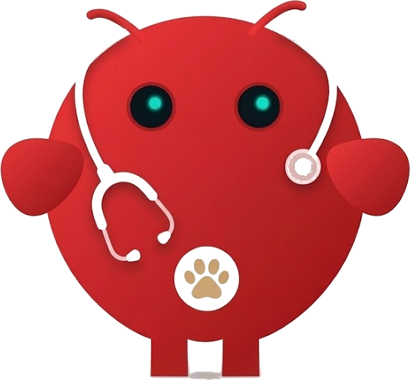

<p align="center">
  
</p>

# VetClaw

**An open veterinary AI skill library for OpenClaw and compatible agent frameworks.**

[](/skills)
[](/skills/clinical)
[](/skills/pharma)
[](/skills/species)
[](/skills/literature)
[](/skills/safety)
[](/skills/databases)
[](/LICENSE)

**English**

> **Note**
> VetClaw is a skill library, not a monolithic application. Install the full collection or copy only the skill folders relevant to your veterinary workflows.

---

## Why VetClaw Exists

There are 869+ medical AI skills for human medicine (see OpenClaw-Medical-Skills). We're not aware of an equivalent open library for veterinary medicine — VetClaw exists to fill that gap.

Veterinary AI is not a subset of human AI. Drug safety varies by species. A dose that saves a dog can kill a cat. Breed predispositions change differential diagnosis rankings. Evidence hierarchies differ (textbooks remain the gold standard; PubMed coverage is sparse for many species). Regulatory frameworks are distinct (FDA CVM, not FDA CDER).

VetClaw encodes this domain knowledge into structured, reusable skills that any OpenClaw-compatible agent can load immediately.

**See it in action:** [Species Safety Checker](/demo/safety-checker.html) | [Cross-Species Drug Safety Matrix](/assets/species-drug-safety-matrix.md) | [Rosie Case Protocol](/cases/rosie-2026)

Built by [OpenVet.ai](https://openvet.ai) -- the AI hospital for every animal on earth.

---

## Important Medical & Legal Disclaimer

VetClaw skills are AI reasoning templates only. They are **not** a substitute for professional veterinary diagnosis, treatment, or clinical decision-making. All outputs must be reviewed and approved by a licensed veterinarian. The authors and OpenVet.ai assume no liability for any clinical use. In oncology or experimental cases, always work under veterinary supervision and comply with local regulations. Always contact your veterinarian or a poison control center (ASPCA 888-426-4435 / Pet Poison Helpline 855-764-7661) in emergencies. Clinical values in these skills are periodically verified against primary literature and drug labels — see [`docs/clinical-review-2026.md`](/docs/clinical-review-2026.md) — and corrections are welcome via the clinical-correction issue template.

---

## At a Glance

| Domain | Skills | Focus |
| --- | --- | --- |
| [Clinical](/skills/clinical) | **17** | Differential diagnosis, emergency triage, clinical guidelines, exam workflows, cardiology, dermatology, ophthalmology, orthopedics, pain, nutrition, dental, anesthesia, wound management, fluid therapy, personalized oncology |
| [Pharma](/skills/pharma) | **8** | Drug lookup, FDA Green Book, drug interactions, adverse event reporting, withdrawal times, compounding, precision medicine/mRNA design, neoantigen vaccine design |
| [Species](/skills/species) | **10** | Breed predisposition, species-aware reasoning, exotic/wildlife, canine, feline, equine, ruminant, avian, camelid, swine |
| [Literature](/skills/literature) | **8** | Veterinary PubMed search, VetEvidence paper grading, evidence hierarchy, textbook hierarchy, comparative medicine, OMIA, VBO, comparative oncology |
| [Safety](/skills/safety) | **5** | Toxicology calculator, lethal variance detection, contraindication checking, anesthesia safety, NSAID safety |
| [Databases](/skills/databases) | **4** | openFDA Animal, FARAD, OBO Foundry ontologies, NCBI Taxonomy |

## Representative Workflows

| Workflow | Example Skills |
| --- | --- |
| Emergency toxicosis | [`toxicology-calculator`](/skills/safety/toxicology-calculator/SKILL.md), [`emergency-triage`](/skills/clinical/emergency-triage/SKILL.md) |
| Drug safety check | [`veterinary-drug-lookup`](/skills/pharma/veterinary-drug-lookup/SKILL.md), [`lethal-variance-detection`](/skills/safety/lethal-variance-detection/SKILL.md) |
| Breed-aware diagnosis | [`breed-predisposition`](/skills/species/breed-predisposition/SKILL.md), [`differential-diagnosis`](/skills/clinical/differential-diagnosis/SKILL.md) |
| Literature review | [`veterinary-pubmed-search`](/skills/literature/veterinary-pubmed-search/SKILL.md), [`vetevidence-grade`](/skills/literature/vetevidence-grade/SKILL.md) |
| Grade a paper | [`vetevidence-grade`](/skills/literature/vetevidence-grade/SKILL.md) (PMID/DOI → live VECS tier); [`evidence-grading`](/skills/literature/evidence-grading/SKILL.md) when there is no identifier |
| Exotic species case | [`exotic-wildlife-medicine`](/skills/species/exotic-wildlife-medicine/SKILL.md), [`species-aware-reasoning`](/skills/species/species-aware-reasoning/SKILL.md) |

## Tested Workflows

Try these prompts in an OpenClaw session after installing VetClaw skills:

**Toxicology triage:**
> "My 10kg dog ate 100g of dark chocolate 2 hours ago. What's the toxicity risk and what do I do?"
>
> Expected: Agent loads `toxicology-calculator` + `emergency-triage`, calculates theobromine dose (~160 mg/kg), flags as potentially severe, and recommends immediate veterinary attention with decontamination protocol.

**Breed-aware cardiology:**
> "7-year-old Cavalier King Charles Spaniel with a Grade IV murmur. Workup?"
>
> Expected: Agent loads `breed-predisposition` + `cardiology-workup`, flags CKCS MMVD predisposition, applies murmur grading and ACVIM staging criteria, recommends echocardiography to assess B1 vs B2.

**Cross-species drug safety:**
> "Can I give acetaminophen to my cat for pain?"
>
> Expected: Agent loads `lethal-variance-detection` + `contraindication-checker`, immediately flags acetaminophen as **lethal in cats** (toxic methemoglobinemia), recommends species-safe alternatives.

**Grade a paper via VetEvidence:**
> "How strong is PMID 27678080 as evidence for a dog?"
>
> Expected: Agent loads `vetevidence-grade`, POSTs `{"pmid":"27678080"}` to `https://vetevidence.com/vecs/score`, and reports the live VECS tier (study strength, verification, and species) without summarizing the paper or inventing a grade.

## Quick Start

OpenClaw loads workspace skills from `<workspace>/skills`. Setup:

```
git clone https://github.com/OpenVet-Projects/VetClaw.git
mkdir -p ~/.openclaw/workspace/skills
cp -R VetClaw/skills/* ~/.openclaw/workspace/skills/
```

Start a new OpenClaw session so skill folders are picked up. If you already keep your workspace in git, merge only the folders you want.

### Using VetClaw with Hermes or other agents

OpenClaw auto-loads `skills/`, but a [Hermes](https://huggingface.co/NousResearch) agent (or any function-calling model) discovers capabilities through **tools**. VetClaw ships a Hermes function-calling integration — a skill-discovery pair (`list_vetclaw_skills` / `get_vetclaw_skill`) backed by [`index.json`](/index.json), plus the openFDA tools — so a Hermes agent can pull the relevant skill on demand, including when it runs in front of OpenClaw. See [`integrations/hermes/`](/integrations/hermes).

## Repository Layout

```
VetClaw/
├── README.md
├── CONTRIBUTING.md · CODE_OF_CONDUCT.md · SECURITY.md · CHANGELOG.md · CITATION.cff · LICENSE
├── index.json           # generated machine-readable manifest of all skills
├── schema/              # JSON Schema for skill frontmatter
├── scripts/             # validate_skills.py, generate_index.py (stdlib-only)
├── sdk/                 # openFDA Animal & Veterinary API clients (Python + TypeScript)
├── integrations/        # Hermes function-calling adapter + generated tool schemas
├── demo/                # browser Species Safety Checker
├── cases/               # documented reference cases (e.g. rosie-2026)
├── assets/              # cross-species drug safety matrix, mascot
├── .github/             # issue/PR templates + CI (skill validation, SDK tests)
└── skills/
    ├── clinical/       # 17 skills: diagnosis, triage, guidelines, exams, specialty workups, personalized oncology
    ├── pharma/         # 8 skills: drug lookup, FDA Green Book, interactions, adverse events, withdrawal, compounding, mRNA design, neoantigen vaccine
    ├── species/        # 10 skills: breed predisposition, species reasoning, canine, feline, equine, ruminant, avian, exotic, camelid, swine
    ├── literature/     # 8 skills: PubMed search, VetEvidence grading, evidence hierarchy, textbook hierarchy, comparative medicine, OMIA, VBO, comparative oncology
    ├── safety/         # 5 skills: toxicology, lethal variance, contraindications, anesthesia safety, NSAID safety
    └── databases/      # 4 skills: openFDA, FARAD, OBO Foundry, NCBI Taxonomy
```

## Design Principles

**Species-first.** Every skill assumes the species matters. Drug skills require species before returning results. Diagnostic skills weight differentials by species and breed. This is the foundational difference from human medical AI skills.

**Evidence hierarchy matches veterinary reality.** In human medicine, PubMed systematic reviews sit at the top. In veterinary medicine, board-certified specialist textbooks (Ettinger's, Plumb's, Nelson & Couto) remain the gold standard for most clinical decisions. These skills encode that hierarchy.

**Safety is not optional.** Veterinary medicine has extreme species-dependent drug safety variance. Acetaminophen is routine in dogs, lethal in cats. Ivermectin is safe in most breeds, neurotoxic in MDR1-mutant collies. Skills in the safety category enforce species disambiguation before any drug information is returned.

**Public data, structured reasoning.** VetClaw skills reference publicly available databases and knowledge (FDA Green Book, OMIA, VBO, PubMed, openFDA). The value is in the structured veterinary reasoning patterns, not proprietary data.

## Reported Case: The Rosie mRNA Cancer Vaccine Story

According to March 2026 press reports (Fortune, The Australian, and others), Australian tech entrepreneur **Paul Conyngham** used AI tools to help design a personalized mRNA cancer vaccine for his rescue dog **Rosie**, who had been diagnosed with aggressive mast cell cancer.

As reported in press coverage, Paul:

- Paid for professional tumor + normal DNA sequencing at UNSW
- Used **ChatGPT** to brainstorm strategy and build analysis pipelines
- Leveraged **AlphaFold** to model neoantigens and protein structures
- Used **Grok** (and Gemini) to refine the final vaccine construct
- Collaborated with nanomedicine pioneer Prof. Thordarson at UNSW's RNA Institute

Press coverage described a personalized mRNA cancer vaccine manufactured in roughly two months, with reported tumor shrinkage and a return to normal activity. **These outcomes have not been peer-reviewed or independently verified**, and many clinical specifics remain unconfirmed — see [`cases/rosie-2026`](/cases/rosie-2026) for a careful account of what is and isn't publicly known.

**VetClaw was not involved in the Rosie case.** We highlight it because it illustrates the kind of structured, species-aware workflow VetClaw is built to support: species-aware safety checks, evidence-hierarchy enforcement, toxicology and lethal-variance guardrails, and breed-predisposition/differential-diagnosis structuring. Combined with an agent runtime and general-purpose tools, VetClaw skills aim to make workflows for personalized oncology, neoantigen identification, and genomics-driven therapies more structured and safer to reason about.

OpenVet.ai aims to take this further, orchestrating these skills into multi-agent clinical rooms with transparent citations and specialist oversight.

We are actively expanding the **Deep Science** category with oncology and personalized-medicine skills.

## Skill Format

Every `SKILL.md` follows the AgentSkills-compatible structure:

```yaml
---
name: skill-name
description: One-line description used for agent skill matching.
---
```

```markdown
# Skill Name
## Overview        -- what this skill enables
## When to Use     -- trigger conditions for the AI agent
## Key Capabilities -- specific tools, APIs, databases
## Workflow         -- step-by-step reasoning pattern
## Output Format   -- what the agent should produce
## Limitations     -- what this skill cannot do
```

## Validation & Machine-Readable Index

Every skill's frontmatter and structure is checked in CI:

```
python3 scripts/validate_skills.py        # lint all SKILL.md files
python3 scripts/generate_index.py         # (re)build index.json
python3 scripts/generate_index.py --check # verify index.json is current (CI)
```

- **[`index.json`](/index.json)** is a generated manifest of all skills (name, category, description, path) that an agent runtime or installer can consume directly — no tree-walking or README parsing required.
- **[`schema/skill.schema.json`](/schema/skill.schema.json)** defines the frontmatter contract: required `name`/`description`, plus optional provenance fields (`version`, `last_reviewed`, `reviewer`, `evidence_tier`, `species`, `sources`).
- The validator accepts workflow-equivalent section headings, so existing skills pass while new contributions are held to the format.

## SDK: Reference Clients for Veterinary Data

VetClaw includes lightweight reference clients for the data sources referenced by skills. These are starter implementations for integrating real veterinary data into your workflows — not full production SDKs. Contributions to expand coverage and add tests are welcome.

**openFDA Animal & Veterinary Adverse Events** — Python and TypeScript clients for querying the FDA's veterinary adverse event database. Search by species, breed, drug, reaction. Count, paginate, and aggregate.

```python
from openfda_vet import OpenFDAVet
client = OpenFDAVet(api_key="YOUR_KEY")
client.top_reactions("Dog", drug="Ivermectin")
client.search(species="Cat", drug="Amoxicillin", limit=10)
```

See [`sdk/`](/sdk) for full documentation, TypeScript client, and API reference.

## Roadmap: From Skills to Tools

VetClaw skills are reasoning templates today. Here is where we are headed:

**Now (v0.1 — Skill Library):** 52 structured skills covering clinical workflows, drug safety, species medicine, and personalized oncology. The neoantigen vaccine design skill includes a complete practical guide: decision trees, lab directories, bioinformatics commands, and synthesis partner options. It is one of the more detailed open resources for veterinary personalized oncology that we're aware of.

**Next (v0.2 — Computational Analysis Tool):** A web interface where veterinary oncologists upload sequencing data (VCF files) and receive ranked neoantigen candidate lists. Built on open-source tools (pVACtools, NetMHCpan, OpenVax pipeline) adapted for canine DLA and feline FLA typing.

**Future (v0.3 — Integrated Pipeline):** Partnerships with veterinary genomics labs and RNA synthesis facilities to offer a coordinated pathway from tumor biopsy through neoantigen analysis to vaccine candidate delivery. Not end-to-end automation (wet lab steps remain physical), but a guided, connected workflow.

If you are a veterinary oncologist, genomics researcher, or RNA synthesis facility interested in collaborating on v0.2 or v0.3, contact us at [openvet.ai](https://openvet.ai).

## Related Projects

| Repository | Relationship |
| --- | --- |
| [OpenClaw](https://github.com/openclaw/openclaw) | The agent runtime VetClaw skills are designed for. |
| [LabClaw](https://github.com/wu-yc/LabClaw) | Stanford/Princeton biomedical research skills. VetClaw complements LabClaw for veterinary-specific use cases. |
| [OpenClaw-Medical-Skills](https://github.com/FreedomIntelligence/OpenClaw-Medical-Skills) | 869 human medicine skills. VetClaw fills the veterinary gap. |
| [ClawBio](https://github.com/ClawBio/ClawBio) | Bioinformatics agent skills. Relevant for veterinary genomics workflows. |

## About OpenVet

[OpenVet.ai](https://openvet.ai) is building the AI hospital for every animal on earth. VetClaw represents our commitment to open veterinary AI infrastructure. For the full clinical platform with specialist rooms, cited evidence, and species-specific decision support, visit [openvet.ai](https://openvet.ai).

## Contributing

We welcome contributions from veterinary professionals, researchers, and developers. If you work with animal health data, veterinary diagnostics, or species-specific medicine, we want your expertise encoded as skills. See [CONTRIBUTING.md](/CONTRIBUTING.md) for guidelines.

## License

[MIT License](/LICENSE)

## Credits

Skills developed by the OpenVet.ai team, drawing on standard veterinary references (Plumb's, Ettinger's, Nelson & Couto, and current consensus guidelines). Corrections and review from practicing veterinarians and board-certified specialists are welcomed — see [CONTRIBUTING.md](/CONTRIBUTING.md).
